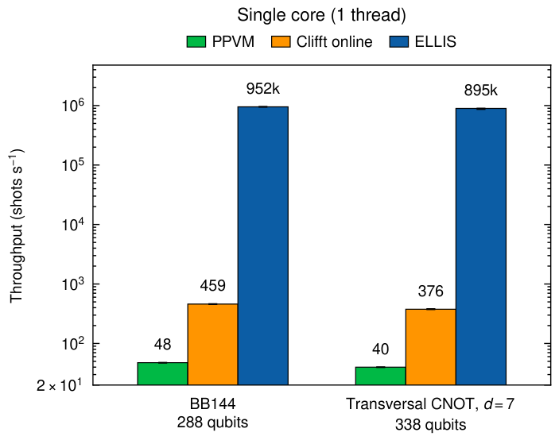

<p align="center">
  
</p>

# ELLIS: Extremely Fast Quantum Circuit Simulation under Qubit Loss and Leakage

[](https://arxiv.org/abs/2611.26173)

ELLIS (Efficient Loss and Leakage Invariant-reference Simulation) samples Clifford circuits with atom loss
exactly. It uses a masked Pauli frame and one shared reference record, so each shot does not need its own
tableau reference.

- **Masked frame sampler.** `ellis.frame` and the C++ engine `ellis._core.MaskFrameSampler`, built on
  Stim's `FrameSimulator`. A lost qubit drops its later gates, and its readouts become fair coins.
- **Common-reference certificates.** `ellis.certify` proves that one reference is exact for every loss
  pattern by frame-CSS relabelling or closed S/CZ blocks, or returns a signed-parity contradiction that
  shows no such reference exists. Pass the circuit with its noise injected: losses and reloads happen at its
  `I_ERROR[loss]` and `I_ERROR[reload]` markers. A circuit with neither marker is certified under
  `PESSIMISTIC` (loss after every operation, |0> reload anywhere), so its reference holds under every loss
  model. An explicit `LossModel` overrides both. `frame_css` decides frame-CSS exactly; a circuit outside the
  assumptions that make the decision exact (classical feedback, multi-qubit measurements, a prefix with
  too many open frame choices) gets verdict `"outside-assumptions"` instead.
- **MSC S-proxy references.** `ellis.msc.reference.CultivationReference` computes a reference for each loss pattern
  from a small prefix tableau and a CSS gauge sweep, and falls back to the full tableau when its checks
  fail.

## Loss instructions

ELLIS reads Stim circuits and adds two tagged `I_ERROR` instructions. Stim parses both and ignores them.

| Instruction | Meaning |
|---|---|
| `I_ERROR[loss](p) q...` | Each atom `q` is lost with probability `p`. Its later gates are dropped and its readouts become fair coins. |
| `I_ERROR[reload](p) q...` | Each empty slot `q` gets a fresh atom in \|0> with probability `p` (default 1). A present atom is left alone. |

A reload happens only where its marker stands. To reload at a reset, write the marker just before it:

```
CX 0 1
I_ERROR[loss](0.001) 0 1
M 1
I_ERROR[reload] 1
R 1
```

## Sampling performance

<p>
  
  
</p>

Sampling throughput on BB144 memory and the distance-7 surface-code transversal CNOT, on one core (left) and
128 threads (right), with loss probability 10<sup>-3</sup> per two-qubit-gate operand, circuit-level
depolarizing noise 10<sup>-3</sup>, no reload, and packed outputs. Bars show the median of five batches;
error bars span the minimum and maximum.

## Install

```bash
uv sync                  # builds ellis._core with CMake (fetches Stim 1.16.0 once)
uv sync --extra sinter   # also sinter, for ellis.sinter
```

The build needs GCC 10 or newer and targets AVX2 by default. For a CPU without AVX2, run
`uv sync -C cmake.define.SIMD_WIDTH=128`. On Perlmutter, CMake selects the `gcc-native` module's
`g++` automatically. Run the first build on a compute node.

## Use

```python
import stim
from ellis import frame
from ellis.certify import certify
from ellis.noise import surface_memory

circuit = surface_memory(d=5, rounds=5, p=1e-3, p_loss=1e-3)  # I_ERROR[loss](p) marks loss sites
cert = certify(circuit)  # losses at the circuit's I_ERROR[loss] markers; verdict "proven", method "frame-css"
sampler = frame.compile_sampler(circuit, reference=cert.reference, seed=1)
dets, obs = sampler.sample_detectors(10**6, bit_packed=True, threads=8)
```

For a circuit without a common reference, such as an MSC S-proxy circuit, pass a per-shot provider to the
numpy sampler:

```python
from ellis.msc.reference import CultivationReference

provider = CultivationReference(circuit)
meas, heralds = frame.sample(circuit, 1000, reference_provider=provider)
```

`ellis.sinter.masked(decoder)` is a `sinter.Sampler`. It samples with the masked frame and decodes with any
sinter decoder.

## Layout

| Path | Contents |
|---|---|
| `src/ellis/frame/` | C++ masked frame: program compilation, `stim::FrameSimulator` with alive masks, batched sampler |
| `src/ellis/reference/` | C++ exact references for a loss pattern: full tableau (`Plan`) and MSC prefix (`FastPlan`) |
| `src/python/bindings.cc` | the `ellis._core` module |
| `src/python/ellis/` | `frame`, `certify/` (`frame_css`, `blocks`, `constraints`), `msc/`, `noise`, `sinter`, `gf2`, `check_exact` |
| `tests/python/` | tests against Stim on explicit lossy circuits; fixtures in `tests/fixtures/` |
| `tools/` | `bench/bench_frame.py` (masked frame and Stim speed), `classify_lightstim.py` (certify each LightStim protocol), fixture exporters |
| `cmake/` | Stim fetch, compiler selection, SIMD flags |

## Test

```bash
uv run pytest
uv run python -m ellis.check_exact 'tests/fixtures/lightstim/*.stim'   # sampler vs Stim on random loss patterns
uv run python tools/classify_lightstim.py --benchmark                  # paper App. C classification
```

## Citation

If you find ELLIS useful in your work, please cite our paper:

```bibtex
@misc{hou2026ellis,
      title={Ellis: Extremely Fast Quantum Circuit Simulation under Qubit Loss and Leakage},
      author={Yuewen Hou and Gokul Subramanian Ravi},
      year={2026},
      eprint={2611.26173},
      archivePrefix={arXiv},
      primaryClass={quant-ph},
      url={https://arxiv.org/abs/2611.26173},
}
```
